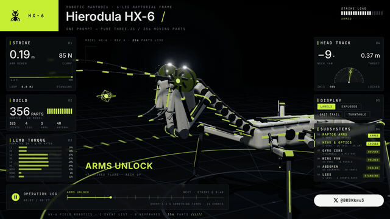
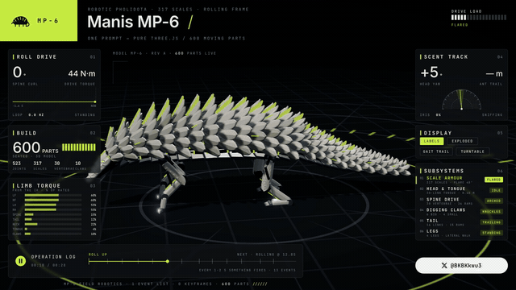

# teardown-forge

[中文使用流程 ↓](#中文使用流程)

A Claude Code skill that turns any machine into a 3D simulator you can take apart, and records it as a 60 fps film with its own score.

Ask for a machine in one sentence. Claude builds it as one offline HTML page on a dark lime console: the machine runs in the middle, every panel around it reads the real numbers, a button opens the part doing the work, and when nobody touches it the page tours itself.



**Hierodula HX-6**, a robotic praying mantis with 356 moving parts: [watch the 27 s film (1080p60, with sound)](docs/mantis-hx6.mp4) · source in `sims/mantis-*`


**Callinectes CB-9**, a robotic blue crab with 500 moving parts: [watch the 28 s film (1080p60, with sound)](docs/crab-cb9.mp4) · source in `sims/crab-*`



**Manis MP-6**, a robotic pangolin with 600 moving parts: [watch the 28.5 s film (1080p60, with sound)](docs/pangolin-mp6.mp4) · source in `sims/pangolin-*`

## Install

```
npx skills add bk19921030315-ai/teardown-forge -g -a claude-code
```

Then, once, in the installed folder:

```
npm install && npx playwright install chromium
```

You need Node.js 20 or newer. For the video you also need `ffmpeg`, and for the sound Python 3.

## Use

One line is enough; the house style (dark console, lime accent, panels, auto tour, film, score) is the default:

> Use teardown to build a robotic dragonfly with 300 moving parts.

> Teardown a hydraulic excavator arm and record the film.

### From a reference picture

Hand Claude one picture and it rebuilds that machine instead of inventing one: it measures the picture, writes a 10 to 12 line checklist for it, renders a grading still posed like the picture, grades every line against it, measures the dark share and the silhouette with `grade.mjs`, and stops after round 2 for your yes before anything gets filmed.

> Use teardown. Read docs/method/JOB_DESCRIPTION.md, then this picture. Build a robotic tarantula with 500 moving parts and stop at the still so I can check it.

The whole method is in [`docs/method/`](docs/method): the job description, the checklist format, every prompt, every lesson, and a [Chinese tutorial](docs/method/TUTORIAL.zh.md).

```
node grade.mjs compare ref.png ref.png                                    # measure the picture first
node grade.mjs still pangolin --t 10.6 --ref ref.png --cam '{"az":-40}'   # a still on the picture's backdrop
node grade.mjs compare ref.png teardown-out/pangolin-grade-10.6.png --out teardown-out/pangolin-r1
```

Open a machine locally:

```
node sims/build.mjs mantis-live      # → teardown-out/dist/mantis-live.html
node sims/build.mjs crab-live        # → teardown-out/dist/crab-live.html
node sims/build.mjs pangolin-live    # → teardown-out/dist/pangolin-live.html
```

## What is inside

| | |
|---|---|
| `SKILL.md` | What Claude reads: the house style, how a machine is built, the rules that make it look right, the review loop. |
| `sims/mantis-*`, `sims/crab-*`, `sims/pangolin-*` | Hierodula HX-6, Callinectes CB-9 and Manis MP-6. `-shared` is the machine, `-live` the page you drive, `-film` the recorded tour. New machines go next to them. |
| `sims/kit/` | Runtime, stage, shader warm-up. |
| `sims/build.mjs` | Bundles a machine into one HTML file, three.js and fonts inlined. |
| `sims/capture.mjs` | Renders the film frame by frame to a 60 fps mp4, or to review sheets of stills. |
| `sfx/`, `run_sfx.py` | Procedural sound on the film's timeline, mastered to −14 LUFS. |
| `docs/method/` | The reference-picture method: job description, checklist, prompts, lessons, Chinese tutorial. |
| `grade.mjs` | Grading stills on the picture's backdrop, side-by-side stacks, dark share and silhouette against the picture. |
| `docs/` | Preview GIFs and films of each machine. |

---

## 中文使用流程

### 1. 安装（只做一次）

在终端运行，把技能装进 Claude Code：

```
npx skills add bk19921030315-ai/teardown-forge -g -a claude-code
```

再进入安装好的技能文件夹，装依赖和录屏用的浏览器：

```
npm install && npx playwright install chromium
```

需要 Node.js 20 以上；录视频要有 `ffmpeg`，配乐要有 Python 3。在 Claude Code 网页版（云端会话）里，Claude 会自己装好这些依赖。

### 2. 做一台新机器（一句话）

对 Claude Code 说一句话就够，风格会自动沿用螳螂这套：深色背景、荧光绿、左右六个面板、底部操作日志、右下角 𝕏 @BKBKkwu3 徽章。

> 用 teardown 做一只机械蜻蜓，300 个运动零件

> 用 teardown 做一个液压挖掘机臂，录成片

> 用 teardown 做一台机械蝎子，参考附件图片

可以附参考图片或视频；写了零件数就会精确对上，并按子系统说明零件分布。

### 3. Claude 会做什么

1. 在 `sims/` 下新建 `<名字>-shared`（机器本身）、`<名字>-film`（成片）、`<名字>-live`（可交互页面）。
2. 按真实尺寸建模，每个运动零件登记一次，面板上的零件数就是登记数。
3. 编排 10–13 个阶段、约 25–30 秒的影片：开场就在动，有主动作、内部展示、拆解和重装，最后离场。
4. 逐个阶段截图检查，修到没有问题为止。
5. 录成 1920×1080、60 fps 的视频，配上同步生成的音乐。

### 4. 成果在哪里

| 成果 | 位置 |
|---|---|
| 可交互网页（离线可开） | `teardown-out/dist/<名字>-live.html` |
| 成片视频 | `teardown-out/<名字>.mp4` |
| 源代码 | `sims/<名字>-*` |

网页没人操作时会自动导览；点右侧子系统或显示按钮就由你接管，可以拖动旋转、滚轮缩放；安静 25 秒后自动回到导览。

### 5. 存到 GitHub

做完后对 Claude 说：

> 提交并推送到 teardown-forge，视频放进 docs，README 加上预览

Claude 会把代码提交到 `main`，把视频和预览动图放进 `docs/`，并在 README 顶部加上这台机器。

### 6. 常用修改

| 想改什么 | 改哪里 |
|---|---|
| 徽章上的账号 | `sims/mantis-shared/console.js` 里的 `HANDLE` |
| 主色（荧光绿） | `sims/mantis-shared/mantis.js` 里的 `ACCENT` |
| 影片的阶段、时间、字幕 | `sims/mantis-shared/kin.js` 里的 `SCRIPT` |
| 镜头角度和远近 | `sims/mantis-shared/film.js` 里的 `VIEW_FN` |

直接对 Claude 说要改的效果也可以，比如「把主色换成橙色」「拆解那段再慢一点」。

### 7. 本地打开已有的机器

```
node sims/build.mjs mantis-live      # 机械螳螂 HX-6，356 个零件
node sims/build.mjs crab-live        # 机械蓝蟹 CB-9，500 个零件
node sims/build.mjs pangolin-live    # 机械穿山甲 MP-6，600 个零件
```

然后用浏览器打开 `teardown-out/dist/` 里对应的 `.html` 文件。

### 8. 参考图模式（照着一张图做）

只用一句话做出来的机械容易像玩具。给 Claude 一张参考图，它会照图还原，流程是：

1. **先量图**：量出身体比例、暗部占比（机械有多密）和轮廓。
2. **写检查清单**：针对这张图写 10–12 条，写代码之前先给你看。
3. **出打分静帧**：照参考图摆姿势，渲染在参考图的背景色上，和参考图并排逐条打「是 / 部分 / 否」。
4. **实测**：暗部占比要达到参考图的 0.8，轮廓差不超过 0.05。
5. **第 2 轮停下等你确认**：你说可以了才拍片。拍片时照搬身体最接近的已有成片，只换身体。

对 Claude 说：

> 用 teardown，先读 docs/method/JOB_DESCRIPTION.md，再看这张图。做一只机械狼蛛，500 个运动零件，做到静帧就停下给我看。

完整中文教程在 [`docs/method/TUTORIAL.zh.md`](docs/method/TUTORIAL.zh.md)，里面有生成参考图的提示词、每一步对 Claude 说的话、检查清单的写法和踩过的坑。每次你纠正 Claude，那一条都会写进 `docs/method/JOB_DESCRIPTION.md`，下一台机器就不会再犯。

## License

MIT, see [LICENSE](LICENSE).
